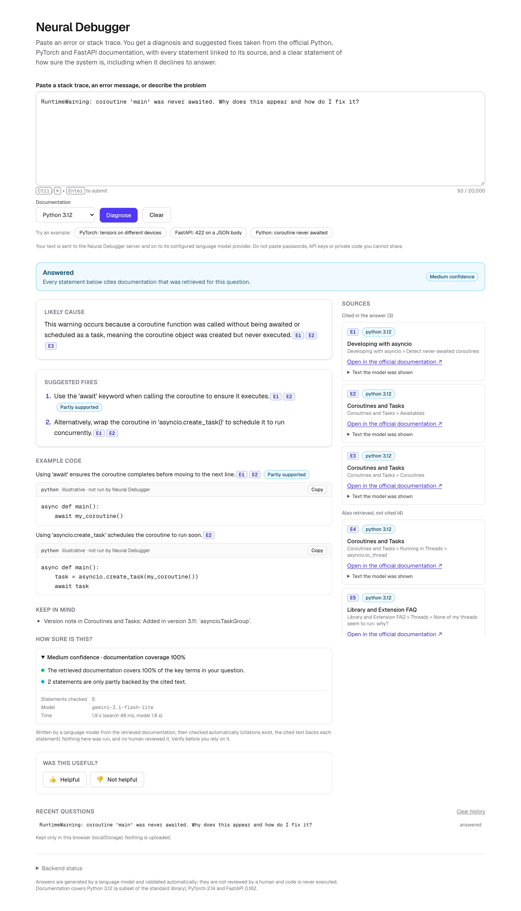
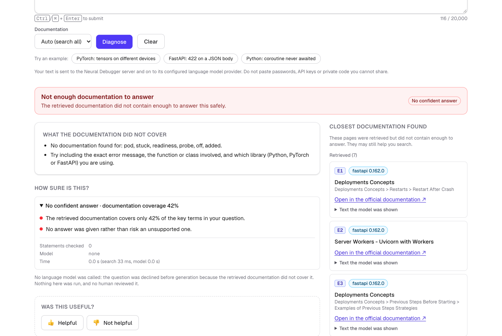
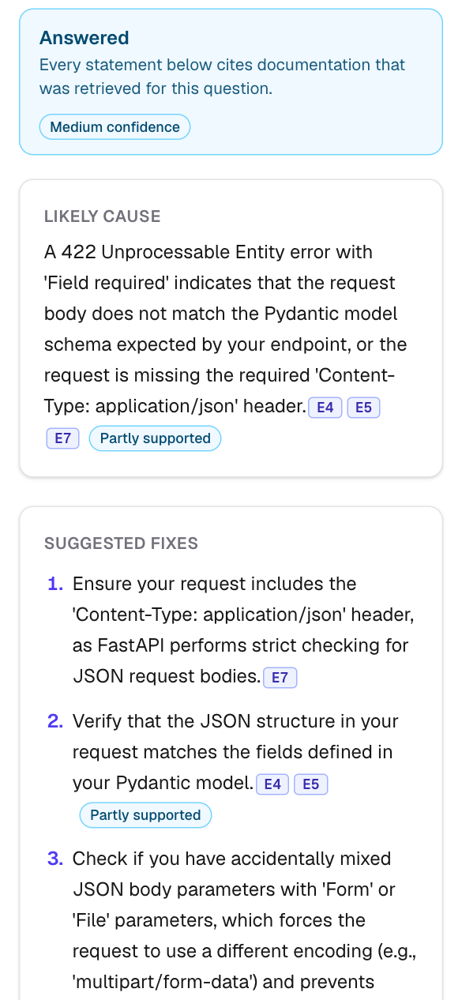
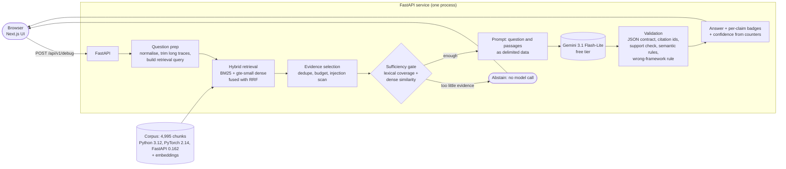

# Neural Debugger

[](https://github.com/KK-0307/neural-debugger/actions/workflows/ci.yml)


**Paste a Python, PyTorch or FastAPI error and get a diagnosis grounded in the official documentation: every statement
carries a citation you can open, the system says how sure it is, and it declines to answer when the documentation cannot
support one.**

A full-stack retrieval-augmented generation (RAG) project: a documentation corpus built from scratch, a measured retrieval
stack (BM25, pretrained dense, hybrid, and a from-scratch PyTorch transformer that *lost* to the baselines and is reported as
such), a validated-citation pipeline over a free-tier LLM (Gemini), a FastAPI backend and a Next.js frontend.

> **Live deployment:** not published yet. The full-stack container is built, tested in CI inside a 512 MB limit and ready for a free
> host ([docs/deployment.md](docs/deployment.md)); run it locally in a few minutes ([Run it yourself](#run-it-yourself)).

<p align="center">
  
</p>

| Answered, with a visible confidence panel | Declined, because the documentation does not cover it | On a phone |
|---|---|---|
|  |  |  |

*Screenshots are the real application answering through the real backend and Gemini 3.1 Flash-Lite (free tier).*

## Why this is interesting

1. **It refuses.** 12 of 12 out-of-scope questions (Kubernetes, Rust, Django...) are declined on a fresh evaluation set, and most
   of them are declined *before the model is called*, by a gate that checks whether the retrieved text covers the question.
2. **Citations are checked, not trusted.** Citation ids must belong to the evidence the model was shown; each claim is then
   checked against its cited text (lexical + semantic rules); claims that fail are removed or badged "partly supported", and a claim
   that cites only the wrong framework's documentation is dropped. Invalid citation ids reaching the user: **0 of 67 claims**
   on the final evaluation (and 0 of 112 on the verbose development set).
3. **The evaluation is honest about itself.** Every labelled number is marked as agent-written, model-generated or
   agent-reviewed (no human reviewed anything); held-out sets are frozen with hashes before changes and never tuned on; a
   negative result (the from-scratch transformer) is in the tables; the gains of the last two milestones are reported as
   **not statistically significant** because they are not.

## Architecture



* **Corpus** (`data/corpus`): 207 pages, 4,154 sections, 4,995 chunks of official documentation, with source URL, anchor,
  version and licence for every chunk; plus a 4-page supplement merged in memory (`data/corpus_supplement`).
* **Retrieval**: hybrid of BM25 and `gte-small` dense vectors with tuned reciprocal-rank fusion, exact vector search.
* **Generation**: provider-agnostic interface; the deployed configuration uses Gemini 3.1 Flash-Lite on the free tier with a
  request cap and pacing. No local model weights, no paid API.
* **Frontend**: Next.js 16 / React 19 / Tailwind 4; citation chips open the exact text the model was shown; an uncertainty panel
  built only from validator counters; abstentions are explained; history stays in the browser.

Details: [architecture](docs/architecture.md) · [RAG pipeline](docs/rag.md) · [web app](docs/frontend.md).

## Results

All numbers below are produced by scripts in this repository and stored under `data/eval/results/`; frozen files are
hash-checked by `make freeze-verify`. Labels and judgments are **LLM-authored, not human-verified**.

### Retrieval (NDCG@10 on 203 authored queries; 138 dev, 32 test)

| system | dev (n=138) | test, original labels (n=32) | test, expanded labels |
|---|---:|---:|---:|
| BM25 (frozen baseline) | 0.552 | 0.597 | 0.569 |
| Dense (`gte-small`) | 0.666 | 0.580 | 0.604 |
| **Hybrid (tuned RRF), deployed** | **0.680** | 0.601 | 0.626 |
| Hybrid + cross-encoder rerank | 0.685 | 0.653 | 0.666 |

The from-scratch transformer (0.58M parameters, trained on synthetic pairs from the documentation) was evaluated on the same test
queries with the Milestone 4 label set, where BM25 scores 0.560: **0.314 as a dense retriever and 0.531 hybridised with BM25**, i.e.
it loses to the baseline (see [ml-model](docs/ml-model.md)).

On dev, hybrid beats BM25 by +0.128 (95% CI [+0.090, +0.169]; 79 queries better, 23 worse). On the small test set the direction
agrees but almost nothing is significant (intervals about ±0.1). The reranker adds nothing significant and costs ~10x latency,
so it is not deployed. Judgments are incomplete (up to 65% of neural top-10 results were unjudged under the original labels),
which is why two label sets are shown. Cost: query p50 0.8 ms (BM25), 10-11 ms (dense/hybrid) on an M4 Max.
[Details](docs/neural-retrieval.md) · [custom transformer, a negative result](docs/ml-model.md).

### End-to-end answers with a real LLM (Gemini 3.1 Flash-Lite, free tier)

Questions were written by Gemini (which never saw the corpus or the system), frozen and hashed **before** each change, and run
once before and once after. In scope = Python, PyTorch or FastAPI; out of scope = other technologies.

| evaluation set | in-scope answered, before → after | out-of-scope declined | invalid citation ids | how much to believe it |
|---|---|---:|---:|---|
| Held-out, 48 questions (M5.2: corpus supplement, evidence profile) | 11/36 (31%) → 14/36 (39%) | 12/12 | 0 of 56 claims | +3 net, sign test p = 0.375: **not significant** |
| Fresh, 54 questions (M5.3: dense-similarity evidence gate, wrong-framework rule) | 12/42 (28.6%) → **16/42 (38.1%)** | 12/12 | 0 of 67 claims | 4 gained, 0 lost, p = 0.125: **not significant** |

On the fresh set my own review of the answers was 11 good / 4 generic / 1 weak (of 16), and of the 26 abstentions 16 were appropriate,
7 borderline and 3 avoidable. Generation latency p50 7.4 s / p95 21 s (free tier; Google sometimes returns 503 "high demand").
The M5.3 gate fix took verbose, conversational questions from 18 of 36 wrongly refused to 1 of 36 on a development set, and
out-of-scope refusals went *up* on all four development sets. [Details and negative results](docs/rag-reliability.md).

### Engineering checks

| | |
|---|---|
| Python tests | 335 passed in the full environment (+1 skipped live-Anthropic test, +1 strict `xfail` documenting a known limitation); `ruff`, `ruff format`, strict `mypy` clean |
| Frontend | 47 tests against a real local HTTP server; `eslint`, `tsc` clean; normal and static builds |
| CI (GitHub Actions) | python, frontend and docker jobs; the Docker job builds the images, smoke-tests the containers (answer, citations, supplement corpus, privacy rules) and runs the full-stack image **inside a 512 MB memory limit** (it fit, OOM-killed: false) |
| Security | key never in the repo or history (scanned), no secrets in images (checked in CI), `npm audit` and `pip-audit` clean at release, validation errors never echo user input, access logs hold no question text |
| Semantic grounding (synthetic adversarial set, 1,066 items) | lexical check alone silently accepts 52% of defective claims, rules 21%, rules + NLI 2.7%; **recall on real model errors is unmeasured** ([details](docs/semantic-grounding.md)) |

## Design decisions (and what they cost)

* **Abstention is a feature with a pre-model gate.** Declining before calling the LLM saves quota and removes a failure mode.
  Cost: the gate over-refuses some answerable questions (three avoidable and seven borderline refusals in the last review).
* **Validated, not trusted, citations.** Cost: the lexical support check falsely rejects about a quarter of faithful
  paraphrases (measured on synthetic pairs), and a claim citing a topically adjacent page can pass as "partly supported" (a strict
  `xfail` test records it).
* **Reference documentation is the only knowledge source.** GitHub issues and Stack Overflow were not ingested (no
  redistribution licence). Cost: "why does X happen" questions often cannot be answered and are refused.
* **Free tier, no local weights, no fallback model.** Cost: latency, 503s under load, free-tier data-use terms (the public
  deployment says so on screen).
* **Pretrained hybrid retrieval over the from-scratch transformer.** The custom encoder (attention, LayerNorm and the dual
  encoder written from scratch, tested against PyTorch's own) is kept and reported, but loses; it is selectable but not the default.
* **One container for the whole app** (`docker/fullstack.Dockerfile`): the FastAPI service also serves the exported Next.js
  frontend, so a free single-container host runs everything with no CORS and one deployment.

[All technical decisions](docs/technical-decisions.md).

## Limitations (read before quoting any number)

* **No human has reviewed any label, judgment or answer.** Evaluation questions are model-written; quality judgments are mine
  (the assistant that built it) and are not independent.
* **Small samples.** 32 authored test queries; 36-42 in-scope questions per end-to-end set. Neither end-to-end gain is statistically
  significant, and the first fusion settings were tuned on dev (selection optimism).
* **Only 38% of in-scope questions get an answer** on the fresh set (Python 14%, PyTorch 43%, FastAPI 57%): the corpus is reference
  documentation, not a troubleshooting knowledge base.
* One live model (Gemini 3.1 Flash-Lite), one run per condition; free-tier output varies from run to run.
* Real-model recall of the semantic claim checks is unmeasured. Code in answers is illustrative and never executed.
* No persistence of answers, no accounts, history is browser-local, feedback is opt-in and unused. Accessibility was designed in and
  spot-checked in one browser, not audited.

[PROGRESS.md](PROGRESS.md) lists, milestone by milestone, what was verified and how.

## Run it yourself

Requirements: Python 3.12 with [uv](https://docs.astral.sh/uv/), Node 24, optionally Docker. A free Gemini key from Google AI
Studio is only needed for live answers.

```bash
git clone https://github.com/KK-0307/neural-debugger && cd neural-debugger
uv sync --extra data --extra neural          # backend + retrieval stack (CPU PyTorch on Linux)
npm --prefix frontend ci
echo 'GEMINI_API_KEY=<your free-tier key>' >> .env     # git-ignored; never printed or committed

# terminal 1: API (a hard cap and 7 s spacing keep you inside the free tier)
ND_LLM_PROVIDER=gemini ND_LLM_MODEL=gemini-3.1-flash-lite ND_LLM_MIN_INTERVAL_SECONDS=7 ND_LLM_MAX_REQUESTS=200 make dev-backend
# terminal 2: UI at http://localhost:3000
make dev-frontend
```

No key? `ND_LLM_PROVIDER=extractive make dev-backend` assembles (stilted) answers from documentation sentences for local testing.

```bash
make check                 # ruff, mypy, pytest, frontend lint + typecheck + tests
make freeze-verify         # every frozen evaluation artefact still matches its recorded hash
make demo-neural Q="RuntimeError: mat1 and mat2 shapes cannot be multiplied (64x784 and 128x10)"   # retrieval only, no key

# the whole application as one container (what a free host runs); Docker required
docker build -f docker/fullstack.Dockerfile -t neural-debugger .
docker run -p 8000:8000 -e GEMINI_API_KEY -e ND_LLM_PROVIDER=gemini -e ND_LLM_MODEL=gemini-3.1-flash-lite \
  -e ND_DEMO_MODE=readonly neural-debugger                  # http://localhost:8000
python scripts/smoke_public.py http://localhost:8000 --answers 3 --check-limits   # verifies a running deployment from outside
```

Reproduce the evaluations: [docs/evaluation.md](docs/evaluation.md), [docs/rag-coverage.md](docs/rag-coverage.md) and
[docs/rag-reliability.md](docs/rag-reliability.md) list the exact commands; live re-runs need a Gemini key and spend free-tier quota.
The public-deployment mode and its limits are described in [docs/demo.md](docs/demo.md) and [docs/deployment.md](docs/deployment.md).

## Repository layout

| Path | Contents |
|---|---|
| `src/neural_debugger/backend` | FastAPI app: `/api/v1/debug`, `/api/v1/feedback`, `/api/v1/config`, `/health`, read-only-mode guard |
| `src/neural_debugger/rag` | question prep, evidence selection, sufficiency gate, prompt, providers, citation + semantic validation, evaluation harnesses |
| `src/neural_debugger/ml` | tokenizer, BM25, encoders, vector index, RRF, reranker, from-scratch transformer and trainer, metrics, freeze manifests |
| `src/neural_debugger/data` | documentation ingestion, chunking, labelled dataset, splits, leakage checks |
| `frontend/` | Next.js app (and the static-export builds) |
| `data/` | corpus, embeddings, evaluation sets and frozen results, manifests, `NOTICE.md` (licences of the documentation) |
| `docker/`, `render.yaml`, `.github/workflows/ci.yml` | images, free-host blueprint, CI |
| `docs/` | architecture, pipeline, evaluation, each milestone's write-up, deployment, portfolio notes |

Docs: [architecture](docs/architecture.md) · [data pipeline](docs/data-pipeline.md) · [evaluation](docs/evaluation.md) ·
[neural retrieval](docs/neural-retrieval.md) · [custom transformer](docs/ml-model.md) · [RAG](docs/rag.md) ·
[semantic grounding](docs/semantic-grounding.md) · [coverage pass](docs/rag-coverage.md) ·
[reliability pass](docs/rag-reliability.md) · [web app](docs/frontend.md) · [deployment](docs/deployment.md) ·
[public demo mode](docs/demo.md) · [technical decisions](docs/technical-decisions.md) · [portfolio notes](docs/portfolio.md).

## License and data

Code: MIT ([LICENSE](LICENSE)). The corpus is derived from the official Python (PSF License v2), PyTorch (BSD-3-Clause) and
FastAPI (MIT) documentation and keeps a link back to every source page; see [data/NOTICE.md](data/NOTICE.md). Evaluation
queries are original work of this project. The pretrained retrieval models (`gte-small`, MIT, and others used in comparisons)
are downloaded at run time, not stored in the repository.

macOS note: if `import neural_debugger` fails inside `.venv`, run `chflags -R nohidden .venv` (see
[docs/neural-retrieval.md](docs/neural-retrieval.md)); `pytest` and `make` do not depend on it.
