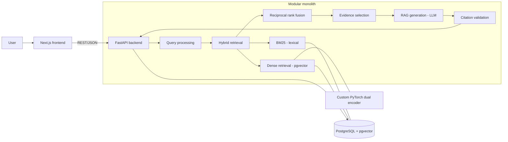

# Architecture

Status legend: **[built]** implemented and tested · **[planned: M#]** scheduled for that milestone, not yet implemented.

## High-level data flow



## Component responsibilities

| Component | Responsibility | Status |
|---|---|---|
| `frontend/` (Next.js, React, TS, Tailwind) | Debug form, results, citations, feedback, analytics view. REST only. Currently a status panel calling `/health`. | skeleton **[built]**; product UI **[planned: M6]** |
| `src/neural_debugger/backend/` (`main`, `config`, `errors`, `middleware`, `logging_config`, `db`, `api/health`) | App factory, typed settings, structured errors (validation errors never echo input), request ids, JSON logs without bodies/query strings, `GET /health` (503 when DB down). | **[built]** |
| `backend/models/`, `backend/services/`, other routers | DB models, query parsing, retrieval orchestration, RAG, citation validation; `/api/debug`, `/api/search`, `/api/feedback`, `/api/sources/{id}`. | **[planned: M5-M6]** |
| `src/neural_debugger/data/` | Reproducible ingestion: polite cached fetcher, Sphinx + FastAPI-markdown parsers, normalisation, structure-aware chunking, exact + MinHash near-dedup, provenance, URL verification; labeled query set, deterministic splits, leakage checks. See [data-pipeline.md](data-pipeline.md). | **[built]** |
| `src/neural_debugger/ml/retrieval/` | Code-aware tokenizer, BM25, random-floor baseline, shared `SearchHit`/`Retriever` types, CLI demo. | **[built]**; dense/pretrained/hybrid/RRF **[planned: M4-M5]** |
| `src/neural_debugger/ml/evaluation/` | Recall@k / MRR / NDCG@10 with bootstrap CIs, evaluation CLI, dev-only BM25 ablation. See [evaluation.md](evaluation.md). | **[built]** |
| `src/neural_debugger/ml/transformer/`, `ml/training/` | Transformer encoder from scratch on PyTorch tensors; InfoNCE training CLI. | **[planned: M3-M4]** |
| `data/` | `corpus/` (processed, committed), `eval/` (labels, results), `manifests/` (hashes, provenance), `raw/` (git-ignored cache). | **[built]** |

## Data flow so far (Milestone 2)

```
configs/sources.yaml -> fetch(cache) -> parse -> normalise -> chunk -> dedupe -> data/corpus/*.jsonl
data/eval/queries_*.yaml + pooled_judgments.yaml -> dataset build -> queries.jsonl (+splits, leakage checks)
corpus + queries -> BM25 -> section ranking -> metrics -> data/eval/results/*.json
```

## Why a modular monolith

One deployable backend process owns API, retrieval and generation. The custom model is a
separately importable and testable package (`ml/`), but it is called in-process: at this scale a
network hop would add latency and operational surface with no benefit (see
[technical-decisions.md](technical-decisions.md)).

## Repository layout

```
src/neural_debugger/     one installable package (hatchling, src layout)
  backend/               FastAPI app           (import neural_debugger.backend)
  data/                  ingestion + datasets  (import neural_debugger.data)
  ml/                    retrieval, evaluation, (later) transformer + training
tests/{backend,data,ml}/ pytest suites
frontend/                Next.js app (separate toolchain)
configs/ data/ docs/ scripts/ docker/ benchmarks/
```

`python -m neural_debugger.<package>.<module>` commands work from anywhere after `uv sync`; the
layout is the same locally, in CI, in wheels and in Docker (no symlinks).

## Runtime topology (Docker Compose)

`db` (pgvector/pgvector:pg16) ← `backend` (FastAPI/uvicorn, :8000) ← `frontend` (Next.js standalone, :3000).
The browser calls the backend directly at `NEXT_PUBLIC_API_URL`, so that URL must be reachable
from the user's browser, and the backend's `ND_CORS_ORIGINS` must include the frontend origin.
